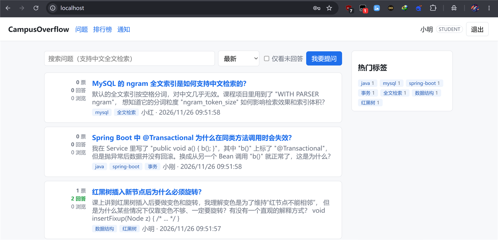

# CampusOverflow · 校园问答平台

面向校园的问答社区：学生提问、同学回答、教师认证、采纳与悬赏激励，声誉与徽章让「认真回答」得到回报。



## 快速开始

前置：**Docker Desktop**（含 WSL2 后端）。不需要本机装 JDK / Node / MySQL —— 镜像里都有。

```bash
# 1) 一键起完整系统（首次构建约 7–10 分钟）
docker compose -f deploy/docker-compose.yml up -d --build

# 2) 等后端就绪（约 40 秒）
docker compose -f deploy/docker-compose.yml ps     # 期望 co-backend 为 Up (healthy)

# 3) 打开浏览器
#    http://localhost
```

> 重新演示前建议清库：`docker compose down -v` 再 `up -d`（`-v` 会删数据卷，仅在需要重置演示数据时使用）。
> 本机若 PowerShell 里 `docker` 命令不存在，先启动 Docker Desktop 并等托盘显示 **Engine running**。

### 演示账号（密码统一 `Campus2026`）

| 学号 / 工号 | 昵称 | 角色 | 用来说明 |
| --- | --- | --- | --- |
| `admin01` | 系统管理员 | 管理员 | 管理端：用户列表、建号、角色调整、校园身份认证 |
| `T2001` | 王老师 | 教师 | 创建课程、教师认证回答、发起悬赏 |
| `TA3001` | 李助教 | 助教 | 课程内助教权限 |
| `2023001` | 小明 | 学生 | 提问、采纳 |
| `2023002` | 小红 | 学生 | 回答、被采纳、获得悬赏 |
| `2023003` | 小刚 | 学生 | 投票、评论 |

演示课程：`CS2001 数据结构（2026-秋）`。

## 功能

### 身份与课程（Identity）
注册、登录（Redis 服务端会话）、课程与课程成员角色（学生 / 助教 / 教师）、校园身份认证、管理员用户管理（列表 / 建号 / 角色调整 / 认证）。

### 问答（Q&A）
提问（标题 / Markdown 正文 / 1–5 个标签 / 关联课程）、回答、评论（支持一层回复与 `@昵称`）、投票（赞 / 踩 / 改投 / 撤销）、采纳、教师认证、软删除（问题与回答）。

### 声誉与激励（Reputation）
只追加的声誉账本与每日对账、徽章（6 种）、悬赏（冻结 → 结算 / 到期退回）、排行榜（本周 / 本月 / 本学期 / 总榜）。

### 发现（Discovery）
搜索、相关问题推荐、通知与 `@提及` —— **Sprint 4 进行中**：领域规则已落地，查询与通知服务仍在实现，当前版本的搜索框、通知页与「相关问题」侧栏尚不可用。

## 技术栈

| 层 | 选型 |
| --- | --- |
| 语言 | Java 21 |
| 框架 | Spring Boot 3.4（Web / Security / Data JPA / Session） |
| 数据库 | MySQL 8（Flyway 管理迁移，ngram 全文索引） |
| 缓存 / 会话 | Redis 7 |
| 前端 | React 18 + TypeScript + Vite 5 |
| 接口契约 | springdoc OpenAPI 3 |
| 部署 | Docker Compose（MySQL / Redis / 后端 / Nginx 前端 / Prometheus / Grafana） |
| CI | GitHub Actions（编译 → Sprint 范围测试 → 架构约束 → 覆盖率） |

## 架构

**模块化单体 + 六边形分层**：4 个限界上下文（Identity / Q&A / Reputation / Discovery）× 5 层（`domain` / `application` / `infrastructure` / `interfaces` / `api`），加共享内核与启动装配，共 **27 个 Maven 模块**。

- 边界由 ArchUnit 守护：领域层零框架依赖、跨上下文只经 `*-api`、无环依赖、表前缀隔离
- 跨上下文集成走**事务性发件箱**（`outbox_event`），最终一致、消费端幂等
- 领域术语见 [`docs/ddd/统一语言.md`](docs/ddd/统一语言.md)，关键决策见 [`docs/adr/README.md`](docs/adr/README.md)

## 项目文档

| 文档 | 内容 |
| --- | --- |
| [`docs/demo.md`](docs/demo.md) | **10 步完整演示脚本**（答辩用） |
| [`docs/demo-声誉.md`](docs/demo-声誉.md) | 声誉专题演示（每一步的数字变化） |
| [`docs/用户手册.md`](docs/用户手册.md) | 面向普通用户的操作说明（含真实截图） |
| [`docs/开发者须知.md`](docs/开发者须知.md) | 环境版本、连接参数、测试基线、教师账号获取、常见报错 |
| [`docs/错误码对照表.md`](docs/错误码对照表.md) | 61 个业务错误码 → 中文提示 / HTTP / 抛出位置 |
| [`docs/adr/`](docs/adr/README.md) | 架构决策记录（ADR-001 ~ ADR-010） |
| [`docs/ddd/`](docs/ddd/统一语言.md) | 领域设计文档 |
| [`docs/交付记录/`](docs/交付记录/README.md) | 按看板卡片归档的截图、终端输出与报告 |
| [`docs/status.md`](docs/status.md) | 当前批次与门禁状态 |
| [`docs/tech-debt.md`](docs/tech-debt.md) | 技术债与待办 |
| [`docs/team-agreement.md`](docs/team-agreement.md) | 团队约定（DoR / DoD / 评审归属） |

## 质量门禁

```bash
# 单元测试（当前 Sprint 必须绿的模块，与 CI 的 SPRINT_MODULES 一致）
mvn -B -f backend/pom.xml test -pl "co-shared-kernel,co-identity/co-identity-domain,co-qa/co-qa-domain,co-qa/co-qa-application,co-reputation/co-reputation-domain,co-reputation/co-reputation-application" -am

# 架构约束（必须始终通过）
mvn -B -f backend/pom.xml test -pl co-bootstrap -am -Dtest=ArchitectureTest -Dsurefire.failIfNoSpecifiedTests=false

# 前端类型检查与构建
cd frontend && npm run typecheck && npm run build
```

> Windows PowerShell 5.1 会把 `-D` 参数按 `.` 拆断，需加 `--%` 前缀；PowerShell 7 或 Git Bash 不需要。

## 贡献指南

- 分支：`feat/xxx`、`fix/xxx`、`docs/xxx`、`ci/xxx`；一个任务一个分支
- 提交：`<type>(<scope>): 中文简述`，type ∈ `feat|fix|test|docs|ci|chore`
- PR：关联 Issue（正文写 `Closes #N`）、附测试/截图证据、右侧栏填 Labels / Milestone / Assignee / Reviewer
- **不直接推送 `main` / `develop`**，一律「分支 → PR → 评审 → 合并」
- 不修改已有测试断言、不删除测试、不加 `@Disabled`
- 完整约定见 [`AGENTS.md`](AGENTS.md)

## 目录结构

```text
backend/    27 个 Maven 模块：co-shared-kernel / co-identity / co-qa / co-reputation / co-discovery / co-bootstrap
frontend/   React + TypeScript 前端（Vite）
deploy/     Dockerfile、docker-compose、Nginx、Prometheus、Grafana
docs/       设计文档、ADR、演示脚本、用户手册、交付记录、进度
http/       接口冒烟脚本（IntelliJ .http + PowerShell）
```
