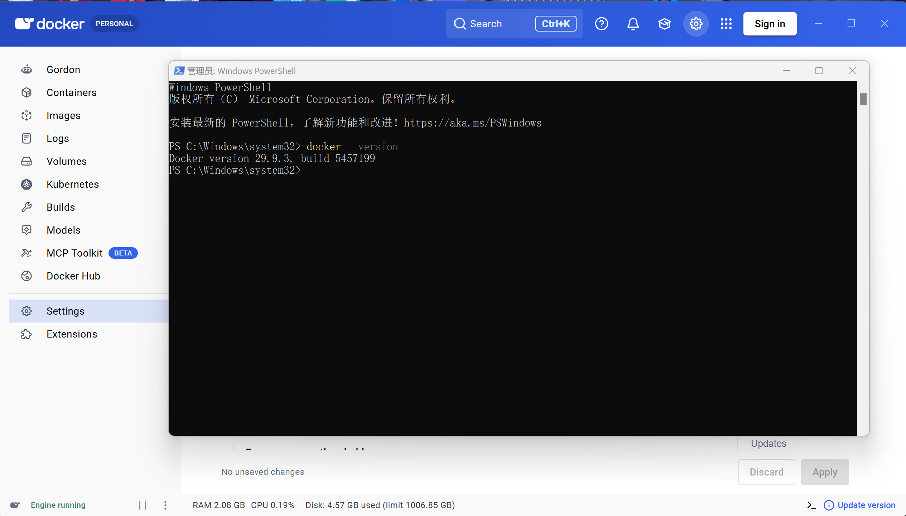
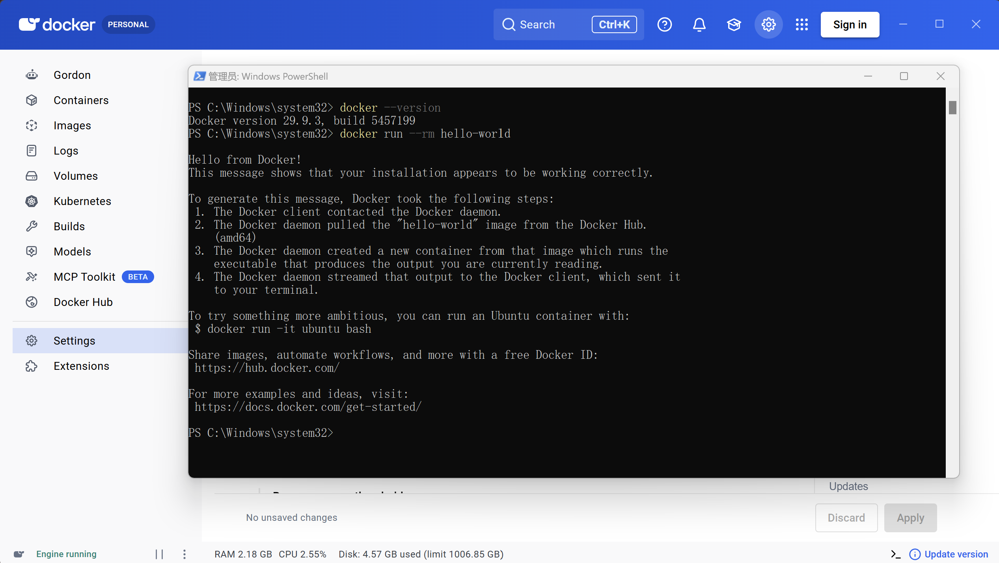
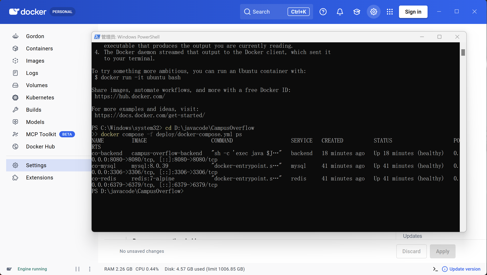

# Docker 环境基线报告

> 本报告对应 Issue `#76`（T4-ENV Docker 环境统一）。
> 采集时间：2026-11-24
> 采集人：代一鸣（qwerbnmv）
> 采集时的 `develop` 提交：`cf2fddb Merge pull request #82`

## 为什么要有这份报告

在本卡开工之前，`develop` 上的测试状态是「除了 Discovery 未实现之外全部绿」。
这个时间点是建立基线的唯一窗口：

- **现在**起 compose 如果失败，只可能是环境问题（Docker / WSL2 / 端口 / 镜像拉取）。
- **等代码写完再起**，失败就分不清是环境没配好还是新代码有问题。

所以本报告的作用是：**先把「环境本身是好的」这件事钉死**，之后的任何失败都能直接归因到代码。
报告里所有数字都是实测值，不是估计。

---

## 一、环境版本

| 项目 | 实测值 | 采集命令 |
| --- | --- | --- |
| 操作系统 | Windows 11 家庭中文版，Build **22631.6199** | `Get-ComputerInfo` |
| Docker Desktop | **4.100.0** | 应用「About」 |
| Docker Engine | **29.9.3**，build `5457199` | `docker --version` |
| WSL | **3.0.1.0** | `wsl --version` |
| WSL 内核 | **6.18.40.1-1** | `wsl --version` |
| WSLg | 1.0.79 | `wsl --version` |
| WSL 默认版本 | **2** | `wsl --status` |
| Compose | v2（`docker compose`，非 `docker-compose`） | `docker compose version` |
| 容器内 CPU 数 | **16** | `docker info` 的 `NCPU` |
| 容器内内存 | **15.3 GiB**（`MemTotal=16396148736`） | `docker info` 的 `MemTotal` |
| 容器 OSType | `linux` | `docker info` |
| 数据盘位置 | `D:\DockerData\DockerDesktopWSL` | Docker Desktop → Settings → VM resources |

### 截图证据

| 检查项 | 截图 |
| --- | --- |
| Docker 版本 + 引擎运行状态 |  |
| `docker run --rm hello-world` 成功 |  |
| `docker compose ps` 三个容器 healthy |  |

### 一个必须记住的环境事实：磁盘镜像默认占 C 盘

Docker Desktop 装完后，WSL2 的磁盘镜像默认落在 `C:\Users\<用户>\AppData\Local\Docker\wsl\`，
随着镜像增多会长到 5–20 GB。**本项目已把它改到 `D:\DockerData\DockerDesktopWSL`**：

- `disk\docker_data.vhdx` — 1.46 GB
- `main\ext4.vhdx` — 0.09 GB

改法：Docker Desktop → **Settings → VM resources → Disk image location** → `Apply & restart`。
（4.100.0 版本里这一页叫 `VM resources`，旧版本叫 `Resources`。）

程序本体仍在 C 盘 `C:\Program Files\Docker`，**占 3.91 GB**，这一块没法搬。

---

## 二、143 个测试在容器环境下的执行结果

### 执行命令

```powershell
mvn -B -o -f backend/pom.xml test `
  -pl co-shared-kernel,co-identity/co-identity-domain,co-qa/co-qa-domain,`
      `co-qa/co-qa-application,co-reputation/co-reputation-domain,`
      `co-reputation/co-reputation-application -am
```

### 结果

**BUILD SUCCESS，耗时 0.3 分钟，143 个测试全绿。**

| 模块 | 测试数 | 明细 |
| --- | --- | --- |
| `co-shared-kernel` | **2** | MaskingTest 2 |
| `co-identity-domain` | **9** | CourseTest 3 / UserTest 6 |
| `co-qa-domain` | **53** | AnswerBoundaryTest 11 / AnswerTest 3 / MarkdownBodyTest 3 / QuestionBoundaryTest 13 / QuestionTest$EditingAndDeleting 3 / QuestionTest$Accepting 5 / QuestionTest$Posting 4 / VoteAndCommentTest 3 / VoteBoundaryTest 8 |
| `co-qa-application` | **37** | AnswerAndVoteServiceTest 7 / CommentServiceTest 5 / QuestionCommandServiceTest 8 / VoteServiceTest 5 / QaQueryApiImplTest 3 / QuestionQueryServiceTest 9 |
| `co-reputation-domain` | **15** | BountyAndAccountTest 6 / ReputationRulebookTest 9 |
| `co-reputation-application` | **27** | BountyServiceTest 5 / ReputationEventHandlersTest 14 / ReputationReadServicesTest 8 |
| **合计** | **143** | |

### ArchUnit 架构测试

```powershell
mvn -B -o -f backend/pom.xml test -pl co-bootstrap -am `
  "-Dtest=ArchitectureTest" "-Dsurefire.failIfNoSpecifiedTests=false"
```

→ `Tests run: 1, Failures: 0, Errors: 0`，**BUILD SUCCESS**。
领域层零框架依赖（FF-1~FF-6）全部通过。

### `mvn verify` 的失败原因：是测试断言，不是连接失败

这是本卡验收标准的第 3 条，必须贴出证据。

`mvn -B -o -f backend/pom.xml verify -DskipITs` → **BUILD FAILURE**，失败模块 `co-discovery-domain`：

```
[ERROR] Failed to execute goal org.apache.maven.plugins:maven-surefire-plugin:3.5.3:test
        (default-test) on project co-discovery-domain: There are test failures.
```

`co-discovery-domain/target/surefire-reports/com.campusoverflow.discovery.domain.DiscoveryDomainTest.txt` 首段：

```
Test set: com.campusoverflow.discovery.domain.DiscoveryDomainTest
-------------------------------------------------------------------------------
Tests run: 5, Failures: 1, Errors: 4, Skipped: 0
com.campusoverflow.discovery.domain.DiscoveryDomainTest.singleCharacterTermsAreRejectedBecauseOfNgramTokenSize
  <<< FAILURE!
java.lang.AssertionError:

Expecting actual throwable to be an instance of:
  com.campusoverflow.shared.domain.BusinessRuleException
but was:
  java.lang.UnsupportedOperationException: TODO(S3)：SearchQuery.terms 尚未实现
	at com.campusoverflow.discovery.domain.search.SearchQuery.terms(SearchQuery.java:46)
	at com.campusoverflow.discovery.domain.search.SearchQuery.<init>(SearchQuery.java:26)
	at com.campusoverflow.discovery.domain.DiscoveryDomainTest.lambda$singleCharacterTermsAreRejectedBecauseOfNgramTokenSize$0(DiscoveryDomainTest.java:35)
```

**结论**：失败是 `AssertionError`（期望业务异常，实际拿到未实现的 `UnsupportedOperationException`），
**不是**连接失败。对 `co-discovery-domain` 的全部 surefire 报告做了正则扫描，
`Connection refused` / `Communications link failure` / `Unable to acquire JDBC` /
`CannotGetJdbcConnection` / `ConnectException` **零命中**。

即：容器里的 MySQL/Redis 是连得上的，红的测试纯粹是 Discovery 领域层还没实现（属 `#60`）。
这正是本卡要事先确认的事情。

---

## 三、15 项扩展检测逐项结果

### 1. Flyway 迁移成功数

**5 个全部成功**，耗时 **2.629 秒**：

```
202609010001 - platform init
202609010100 - identity init
202609010200 - qa init
202609010300 - reputation init
202609010400 - discovery init
Successfully applied 5 migrations to schema campus_overflow, now at version v202609010400
Successfully validated 5 migrations
```

### 2. 四个上下文分别建了几张表

共 **20 张表**：

| 上下文 | 表 | 数量 |
| --- | --- | --- |
| 平台 | `audit_log`、`outbox_event`、`processed_event`、`flyway_schema_history` | 4 |
| Identity | `id_user`、`id_course`、`id_course_member` | **3** |
| Q&A | `qa_question`、`qa_answer`、`qa_comment`、`qa_vote`、`qa_tag`、`qa_question_tag` | **6** |
| Reputation | `rep_account`、`rep_ledger`、`rep_badge`、`rep_bounty` | **4** |
| Discovery | `dis_search_doc`、`dis_notification`、`dis_question_tag` | **3** |

### 3. MySQL 参数

| 参数 | 期望 | 实测 |
| --- | --- | --- |
| `ngram_token_size` | 2 | **2** |
| `innodb_ft_enable_stopword` | OFF | **OFF** |
| `time_zone` | +00:00 | **+00:00** |
| `character_set_server` | utf8mb4 | **utf8mb4** |
| `collation_server` | utf8mb4_0900_ai_ci | **utf8mb4_0900_ai_ci** |
| `VERSION()` | 8.0.39 | **8.0.39** |

`ngram_token_size=2` 是中文全文检索的关键——默认值 1 会让单字也进索引，导致中文搜索噪声极大。

### 4. Redis 命名空间

`PING → PONG`，观测到的键：

| 键 | 说明 |
| --- | --- |
| `co:session:sessions:<uuid>` | Spring Session，共 **6 个** |
| `lb:month:2026-11` | 月榜缓存 |
| `lb:week:2026-W48` | 周榜缓存 |
| `qa:list:gen` | 列表缓存版本号 |

### 5. Session TTL

`co:session:sessions:<uuid>` 的 TTL 实测 **1689 秒**。

`application.yml` 里 `spring.session.timeout: 30m` = 1800 秒，会话创建后过了一段时间，
所以剩余 1689 秒符合预期——**TTL 机制正常工作，没有配置丢失**。

### 6. readiness 探针

`http://localhost:8080/actuator/health/readiness` → **HTTP 200**，响应体 `{"status":"UP"}`。

⚠️ 用 PowerShell 5.1 时 `Invoke-WebRequest` 的 `.Content` 是 `Byte[]`，
需要 `[Text.Encoding]::UTF8.GetString($r.Content)` 解码才能看到字符串。

### 7. actuator 端点暴露范围

`/actuator` 根路径返回 **401**（未授权），这是合理的安全配置。
实际可用的端点：

| 端点 | 结果 |
| --- | --- |
| `/actuator/health/readiness` | 200 `{"status":"UP"}` |
| `/actuator/health/liveness` | 200 |
| `/actuator/prometheus` | 200，含全部业务指标 |

### 8. 5 个业务指标

全部出现在 `/actuator/prometheus` 中：

| 指标 | 实测值 |
| --- | --- |
| `co_outbox_backlog` | **0.0** |
| `co_outbox_published_total` | **26.0** |
| `co_outbox_failed_total` | **0.0** |
| `co_outbox_dead_letters` | **0.0** |
| `co_reputation_mismatches` | **0.0** |

`backlog=0` + `failed=0` + `dead_letters=0` 说明发件箱在**持续排空且无失败**。

### 9. 发件箱投递（★ 必须有明确结论）

**结论：发件箱投递正常，消费链完整。**

| 项 | 实测值 |
| --- | --- |
| `outbox_event` 总条数 | **26** |
| 已投递（`published_at IS NOT NULL`） | **26** |
| 待投递（`published_at IS NULL`） | **0** |
| 累计重试次数 | **0** |
| 任何 `last_error` | **NULL** |

事件类型分布覆盖 **10 种**：

| 事件类型 | 条数 |
| --- | --- |
| `UserRegisteredEvent` | 6 |
| `BadgeAwardedEvent` | 4 |
| `ReputationChangedEvent` | 4 |
| `QuestionPostedEvent` | 3 |
| `VoteCastEvent` | 3 |
| `AnswerSubmittedEvent` | 2 |
| `AnswerEndorsedEvent` | 1 |
| `AnswerAcceptedEvent` | 1 |
| `CommentPostedEvent` | 1 |
| `BountyOpenedEvent` | 1 |

关键在于 **`BadgeAwardedEvent` 与 `ReputationChangedEvent` 也出现在表里**——
这两个是 Q&A 事件被下游声誉上下文消费后**产生的新事件**，
说明「Q&A 发事件 → OutboxRelay 投递 → ReputationEventHandlers 消费 → 记账 → 发新事件」这条链是通的。

**端到端实测**：以教师 `T2001` 登录并发布一个问题（`questionId=4`），
3 秒内 `outbox_event` 出现：

```
id=27  event_type=QuestionPostedEvent
occurred_at=2026-11-24 07:51:44.114541
published_at=2026-11-24 07:51:44.144246   attempts=0   last_error=NULL
```

从写入到投递 **29.7 毫秒**。

### 10. 消费者未堵塞

由第 9 项直接推出：`attempts=0` 且 `last_error=NULL` 意味着没有任何一次投递重试，
即消费者没有抛异常、没有触发指数退避、更没有进死信（`co_outbox_dead_letters=0`）。

### 11. ArchUnit

见第二节：`Tests run: 1, Failures: 0, Errors: 0`，**通过**。

### 12. 前端镜像

`campus-overflow-web:latest` 构建成功，容器 `co-web` 启动后
`http://localhost/` 返回 **HTTP 200，430 字节**（SPA 的 index.html 外壳）。

### 13. 镜像大小

| 镜像 | 大小 |
| --- | --- |
| `campus-overflow-backend:latest` | **447 MB** |
| `campus-overflow-web:latest` | **73.9 MB** |
| `mysql:8.0.39` | 785 MB |
| `redis:7-alpine` | 58.5 MB |
| `node:20-alpine`（构建用，多阶段中间层） | 194 MB |
| `nginx:1.27-alpine`（web 运行时基数） | 74.5 MB |

后端 447 MB 主要来自 `eclipse-temurin:21-jre-alpine` 基础层 + Spring Boot fat jar。

### 14. 构建耗时

| 镜像 | 耗时 | 备注 |
| --- | --- | --- |
| backend | **4.1 分钟** | 首次构建，含 Maven 依赖下载 |
| web | **0.6 分钟** | 预拉基础镜像之后 |
| mysql + redis 容器启动 | **23.3 秒** | `up -d` 到 `healthy` |

⚠️ **首次构建前必须预拉基础镜像**。实测遇到多次：

```
failed to fetch anonymous token: Get "https://auth.docker.io/token?scope=repository%3Alibrary%2Fmaven%3Apull":
dial tcp [2a03:...]:443: connectex: A connection attempt failed
```

原因是 Docker Hub 的 IPv6 地址不可达。解法：

```powershell
docker pull maven:3.9-eclipse-temurin-21
docker pull eclipse-temurin:21-jre-alpine
docker pull node:20-alpine
docker pull nginx:1.27-alpine
docker compose -f deploy/docker-compose.yml build
```

### 15. 时区一致性（★ 必须有明确结论）

**结论：全链路统一 UTC，无时区错乱。**

| 观测点 | 实测值 | 与 UTC 是否一致 |
| --- | --- | --- |
| 宿主 UTC | `2026-11-24 08:06:27` | — |
| 宿主本地 | `2026-11-24 16:06:27`（China Standard Time，UTC+8） | ✅ 差 8 小时，正确 |
| 容器内 `date -u` | `2026-11-24 08:06:27 UTC` | ✅ 与宿主 UTC 完全一致 |
| 容器内 `date`（不带 -u） | `2026-11-24 08:06:27 UTC` | ✅ 容器 `TZ=UTC` 生效，本地时间即 UTC |
| MySQL `NOW()` | `2026-11-24 08:06:28` | ✅ |
| MySQL `UTC_TIMESTAMP()` | `2026-11-24 08:06:28` | ✅ 两者相等，说明会话时区就是 UTC |
| MySQL `@@time_zone` | `+00:00` | ✅ |
| MySQL `@@system_time_zone` | `UTC` | ✅ |
| `outbox_event.occurred_at` 存值 | `2026-11-24 07:51:44.114541` | ✅ 存的是 UTC，非本地时间 |
| 后端日志时间戳 | `2026-11-24T07:41:47.411Z` | ✅ 带 `Z` 后缀 = UTC |

这一项之所以重要：本项目是**双语时间场景**（`AcademicTerm` 用 `Asia/Shanghai` 算学期，
`ReputationRulebook` 的每日上限用 UTC 算自然日）。
如果容器时区跑偏，会出现「北京时间早 8 点前的投票算进前一天」这类难以复现的 bug。
实测证明 compose 里 `TZ: UTC` 与 MySQL 的 `--default-time-zone=+00:00` 都已生效。

---

## 四、容器 vs 本地：差异分析

| 维度 | 本地（Windows 直接跑） | 容器 |
| --- | --- | --- |
| MySQL 版本 | **8.4.8**（本机已装） | **8.0.39**（`mysql:8.0.39`） |
| MySQL 字符集 | 安装时默认，需手工改 | 启动参数强制 `utf8mb4_0900_ai_ci` |
| `ngram_token_size` | 默认 1，需改 `my.ini` 并重启 | 启动参数强制 **2** |
| 时区 | 系统本地时间（UTC+8） | 强制 **UTC** |
| Redis | 本机**未装** | `redis:7-alpine`，开 AOF，256 MB 上限 LRU |
| 端口 | 3306 可能被本机 MySQL 抢占 | 显式映射，冲突时先停本机服务 |
| 数据持久化 | 本机数据目录 | 命名卷 `mysql-data`，`docker compose down -v` 可清空 |
| 复现性 | 依赖每台机器的安装过程 | 一条 `docker compose up -d` |

### 三个值得注意的差异

**1. MySQL 版本差 8.4 vs 8.0**
本机是 8.4.8，容器是 8.0.39。Flyway 的 5 个迁移脚本在两个版本上都能跑通
（本报告第 1 项就是容器 8.0.39 的实测），但 `tech-debt` 的 B1 项担心的正是这一点——
现在可以标记为**已验证**。

**2. 时区在本地是 UTC+8，在容器是 UTC**
本地跑 `mvn test` 时 JVM 时区是 Asia/Shanghai，容器里是 UTC。
本项目所有领域测试都用 `Clock.fixed(...)` 注入固定时刻，**不依赖 JVM 默认时区**，
所以 143 个测试在两个环境下结果一致。但如果以后有人写依赖 `LocalDate.now()` 的测试，
会在两个环境下表现不同——这是要注意的。

**3. 本机 MySQL 服务必须改成手动启动**
本机 `MySQL` 服务原本是 `StartType=Automatic`，开机自启会抢占 3306，
导致容器 `co-mysql` 起不来（`bind: address already in use`）。
**已改成手动**：

```cmd
sc config MySQL start= demand
```

（`start=` 后面必须有空格。cmd 里没有 `Set-Service` 这个 cmdlet，那是 PowerShell 的。）

---

## 五、自检脚本 `http/docker-check.ps1`

脚本位于 `http/docker-check.ps1`，**UTF-8 with BOM**（PowerShell 5.1 需要 BOM 才能正确读中文）。

```powershell
# 全量检查（含后端与前端容器）
.\http\docker-check.ps1

# 只检查中间件，跳过应用容器
.\http\docker-check.ps1 -SkipApp
```

**实测结果：12/12 全过，`exit 0`。**

| # | 检查项 |
| --- | --- |
| 1 | `docker` 命令可用 |
| 2 | Docker daemon 在运行 |
| 3 | WSL2 已安装且默认版本为 2 |
| 4 | 端口 3306 / 6379 未被非本项目进程占用 |
| 5 | compose 文件可解析 |
| 6 | mysql + redis 容器 healthy（backend / web 运行中） |
| 7 | MySQL 关键参数 + 四上下文表齐全 |
| 8 | Redis 可连接 |
| 9 | `dis_search_doc` 有全文索引 |
| 10 | readiness 200 + 5 个业务指标 |
| 11 | 前端首页返回 200 |
| 12 | 时区一致性 |

脚本会自动把 `C:\Program Files\Docker\Docker\resources\bin` 加入 `PATH`，
所以即使当前终端是在装 Docker **之前**打开的，也能直接跑。

---

## 六、已知问题与注意事项

### 1. Docker Hub 拉取会随机超时

见第三节第 14 项。**先 `docker pull` 再 `build`** 可以规避。

### 2. `mysql -p密码` 会污染输出

`docker exec co-mysql mysql -uroot -p密码` 会把
`Using a password on the command line interface can be insecure`
写到 stderr，被 PowerShell 包成 ErrorRecord 混进输出，导致按行解析全错位。

**正确写法**：

```powershell
docker exec -e MYSQL_PWD=root_dev_pwd co-mysql mysql -uroot -e "SELECT 1;"
```

### 3. PowerShell 5.1 发中文 JSON 会变乱码

`Invoke-RestMethod -Body $json` 会按 ANSI(GBK) 编码，导致
`422 QA-1004 标签格式不正确：????`。

**正确写法**：

```powershell
$r = Invoke-WebRequest -Uri $url -Method Post `
  -Body ([Text.Encoding]::UTF8.GetBytes($json)) `
  -ContentType 'application/json; charset=utf-8'
```

### 4. `Invoke-WebRequest` 的 `.Content` 是 Byte[]

PowerShell 5.1 下拿到的是字节数组，要 `[Text.Encoding]::UTF8.GetString($r.Content)` 才能看到字符串。

### 5. 演示数据只在空库时生成

`DemoDataSeeder` 第一行是：

```java
if (identity.findByDisplayName("系统管理员").isPresent()) return;
```

库里已有数据就直接跳过。**答辩前需要清库重建**，否则历史用户没有声誉账户，
教师账号拿不到 1000 悬赏积分。

清库命令：

```powershell
docker compose -f deploy/docker-compose.yml down -v
docker compose -f deploy/docker-compose.yml up -d
```

---

## 附：完整复现步骤

```powershell
# 0. 确认本机 MySQL 不会抢 3306（只需做一次）
sc config MySQL start= demand

# 1. 启动中间件
cd D:\javacode\CampusOverflow
docker compose -f deploy/docker-compose.yml up -d mysql redis

# 2. 等到 healthy
docker compose -f deploy/docker-compose.yml ps

# 3. 跑测试（143 个应全绿）
mvn -B -o -f backend/pom.xml test `
  -pl co-shared-kernel,co-identity/co-identity-domain,co-qa/co-qa-domain,`
      `co-qa/co-qa-application,co-reputation/co-reputation-domain,`
      `co-reputation/co-reputation-application -am

# 4. 跑架构测试
mvn -B -o -f backend/pom.xml test -pl co-bootstrap -am `
  "-Dtest=ArchitectureTest" "-Dsurefire.failIfNoSpecifiedTests=false"

# 5. 起应用（首次前先预拉镜像）
docker pull maven:3.9-eclipse-temurin-21
docker pull eclipse-temurin:21-jre-alpine
docker compose -f deploy/docker-compose.yml up -d --build backend web

# 6. 一键自检
.\http\docker-check.ps1
```
