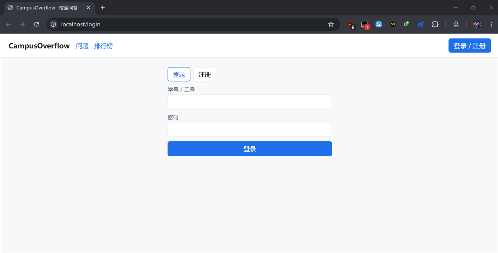
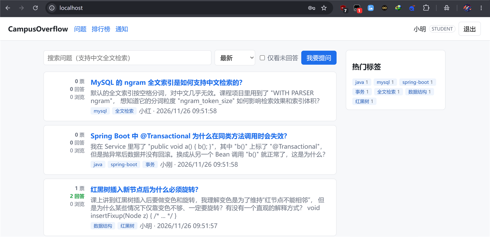
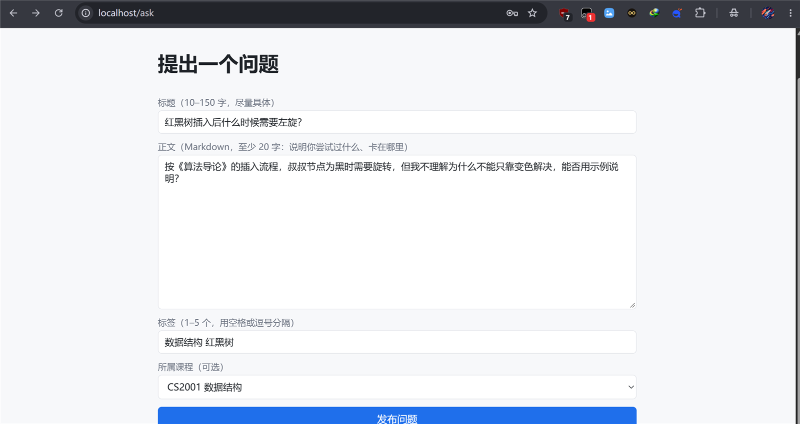
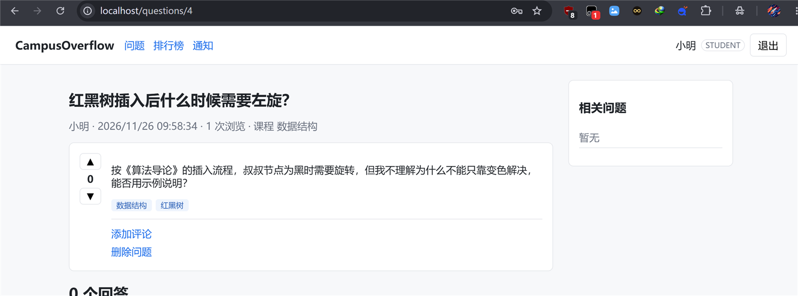
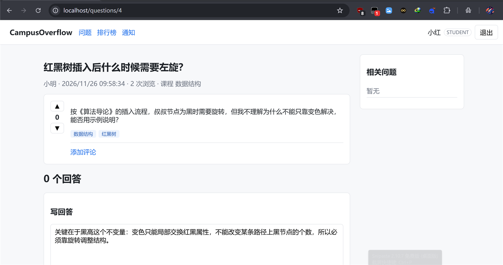
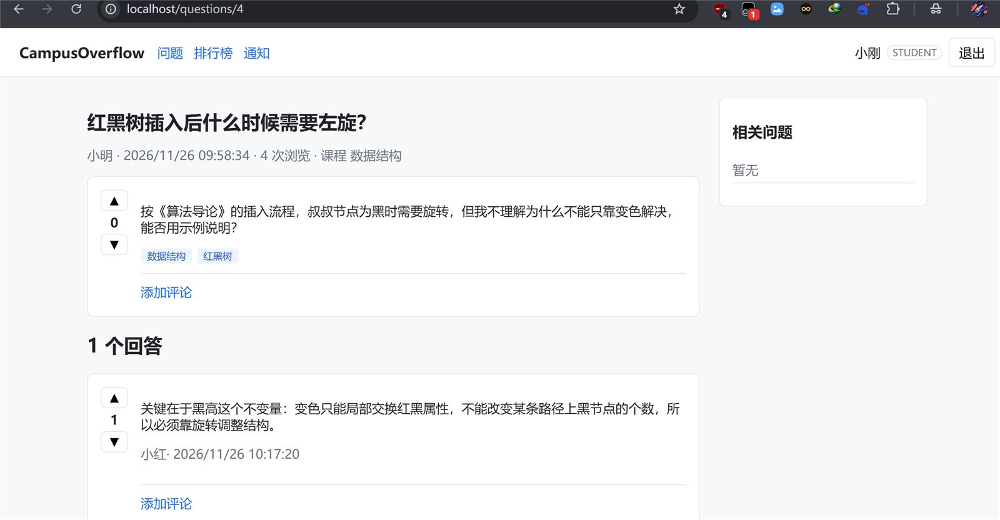
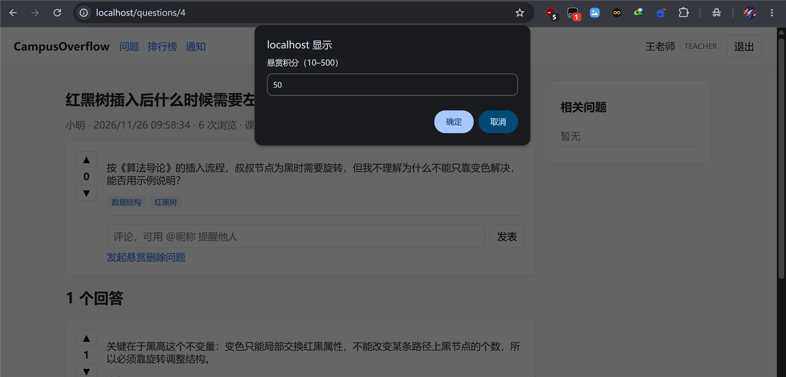
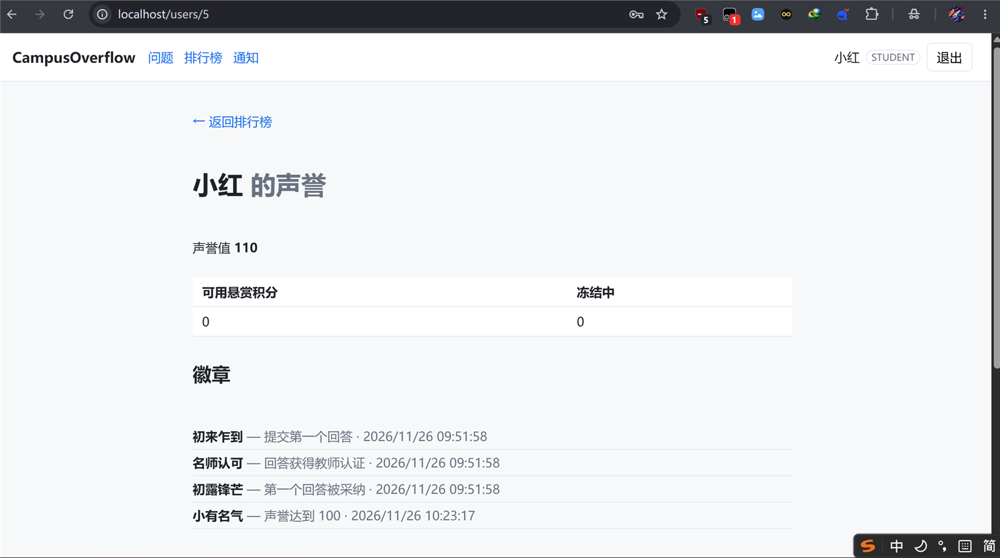
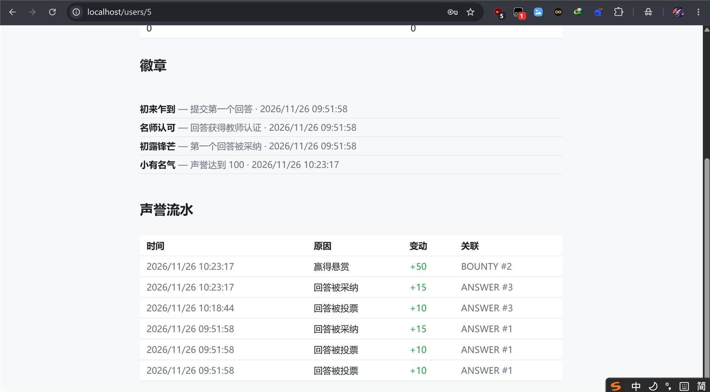
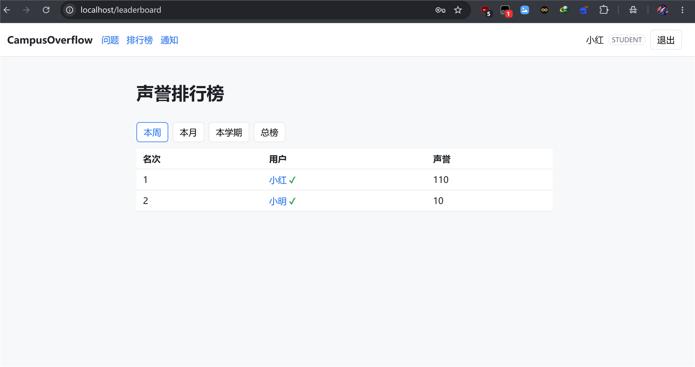

# CampusOverflow 用户手册

> 面向「会用电脑、但不了解技术细节」的用户。
> 每一节都是「照着点就能完成」的步骤，截图全部来自真实运行的系统（`docs/交付记录/Tourbillion-ANG/T4-ENV-docker-env/`）。
> 演示账号与密码见 [README](../README.md#演示账号密码统一-campus2026)。

## 目录

1. [注册与登录](#1-注册与登录)
2. [提问](#2-提问)
3. [回答与评论](#3-回答与评论)
4. [投票、采纳与教师认证](#4-投票采纳与教师认证)
5. [悬赏](#5-悬赏)
6. [声誉、徽章与排行榜](#6-声誉徽章与排行榜)
7. [常见问题](#7-常见问题)

---

## 0. 打开系统

浏览器访问 <http://localhost>，看到顶部导航即表示系统正常：

```text
CampusOverflow    问题    排行榜    [通知]          登录 / 注册
```

- 未登录时右上角是「**登录 / 注册**」
- 登录后右上角显示**昵称 + 角色**（如 `小明 STUDENT`）和「退出」
- 「通知」入口只有登录后出现（当前版本通知功能尚未开放，见第 7 节）

---

## 1. 注册与登录

### 演示账号（密码统一 `Campus2026`）

| 学号 / 工号 | 昵称 | 角色 |
| --- | --- | --- |
| `admin01` | 系统管理员 | 管理员 |
| `T2001` | 王老师 | 教师 |
| `TA3001` | 李助教 | 助教 |
| `2023001` | 小明 | 学生 |
| `2023002` | 小红 | 学生 |
| `2023003` | 小刚 | 学生 |

演示课程：`CS2001 数据结构（2026-秋）`。

### 登录（已有账号）

1. 点右上角「**登录 / 注册**」
2. 页面有「登录」「注册」两个标签，默认停在「登录」
3. 填写**学号 / 工号**和**密码**
4. 点蓝色「**登录**」按钮



登录成功后回到首页，右上角显示昵称，问题列表出现三条演示问题：



### 注册（新用户）

1. 点右上角「**登录 / 注册**」→ 切到「**注册**」标签
2. 依次填写：学号 / 工号、密码、昵称、校园邮箱、学院、班级
3. 点「**注册并登录**」—— 注册成功会**直接登录**并回到首页

**填写规则**

| 字段 | 规则 |
| --- | --- |
| 学号 / 工号 | 4–20 位字母或数字，注册后不可修改 |
| 密码 | 8–64 位，必须同时包含字母和数字 |
| 昵称 | 2–20 个字符，不能含 `@` 或空格，全站唯一 |
| 校园邮箱 | 格式正确的邮箱，全站唯一 |
| 学院 / 班级 | 可留空，最多 50 字 |

> 连续输错密码会临时锁定约 1 分钟。

---

## 2. 提问

1. 登录后点击首页右侧蓝色按钮「**我要提问**」（也可访问 `/ask`）
2. 填写四项内容：

| 项 | 说明 |
| --- | --- |
| 标题 | 10–150 字，写清「在哪一步、遇到什么现象」 |
| 正文 | 至少 20 字，支持 Markdown；说明**试过什么、卡在哪里** |
| 标签 | 1–5 个，用空格或逗号分隔，例如 `数据结构 红黑树` |
| 所属课程 | 可选；下拉里只出现**你已加入的课程**（示例：`CS2001 数据结构`） |



3. 点底部「**发布问题**」→ 自动跳到该问题的详情页



> 提问**不加声誉**；声誉来自「你的回答被投票」与「你的回答被采纳」。
> 提问者本人可以「删除问题」（软删除，内容不可见但数据保留）。

---

## 3. 回答与评论

### 回答

1. 打开某个问题详情页，页面底部有「**写回答**」输入框
2. 输入内容（至少 10 字，支持 Markdown，代码用 ` ``` ` 包裹）
3. 点「**提交回答**」



> 提交按钮在输入框下方，内容较长时需要向下滚动才能看到。

### 评论

1. 问题或回答下方点「**添加评论**」
2. 输入框提示为「**评论，可用 @昵称 提醒他人**」，内容 2–600 字
3. 点「**发表**」

评论支持**一层回复**：在别人的评论下点「回复」；不支持对回复再回复。

> `@昵称` 目前只是**文本标记**，被提到的人**不会收到通知**（通知功能在 Sprint 4 实现中）。
> 昵称必须与人家的**昵称**完全一致（不是学号）。

---

## 4. 投票、采纳与教师认证

### 投票（所有登录用户）

- 问题或回答左侧有 `▲` / `▼` 两个按钮
- 点 `▲` 赞、点 `▼` 踩；再点一次相同按钮 = **撤销**
- 从赞改成踩（或反过来）= **改投**，按「新效果 − 旧效果」计分
- **不能给自己的内容投票**



| 动作 | 对方声誉变化 |
| --- | --- |
| 被赞 | `+10` |
| 被踩 | `−2` |
| 撤销赞 / 撤销踩 | `−10` / `+2` |
| 赞改踩 / 踩改赞 | `−12` / `+12` |

### 采纳（只有提问者或课程管理者）

1. 打开自己的问题
2. 在目标回答下点「**采纳此回答**」
3. 该回答左上角出现 `✔`，问题状态变为「已采纳」
4. 一道题**只能采纳一个**回答，采纳后不能更换

采纳后：回答者声誉 `+15`（**自己采纳自己的回答不加分**）。

### 教师认证（只有课程教师 / 助教）

1. 用教师或助教账号打开问题
2. 在某条回答下点「**教师认证**」
3. 该回答出现「教师认证 · 王老师」标记

> 教师认证**不改变声誉**，它授予回答者「名师认可」徽章；加分仍只来自投票与采纳。

---

## 5. 悬赏

悬赏是**课程管理者**（教师 / 助教）为某个问题「加价求答案」的功能。

### 谁能发

- 只有**课程教师 / 助教 / 管理员**可以发起（学生会被拒绝：`REP-3001 只有课程管理者可以发起悬赏`）
- 学生账户没有悬赏积分（开户 `0` 分）；教师 `1000` 分、助教 `500` 分
- 同一个问题**同时只能有一个进行中的悬赏**

### 怎么发

1. 用教师账号打开一个问题（该问题必须**未被采纳、未删除**）
2. 点「**发起悬赏**」
3. 弹出浏览器输入框，标题为「**悬赏积分（10–500）**」，预填 `50`
4. 输入 `10–500` 之间的整数 → 点「确定」



> 当前版本的悬赏**只能填积分**，期限固定 7 天（不是「积分 + 天数」两个输入框）。
> 页面上「发起悬赏」与「删除问题」两个链接挨得比较近，点击时注意不要点错。

发起后：发起人可用积分 `−50`、冻结积分 `+50`、**声誉不变**。

### 怎么结算

| 情况 | 结果 |
| --- | --- |
| 问题被采纳 | 悬赏 `OPEN → AWARDED`：获奖者**声誉 +悬赏分**；发起人冻结积分消失（不转成对方钱包） |
| 到期未采纳 | 悬赏 `OPEN → EXPIRED`：冻结积分**原路退回**发起人可用积分 |
| 采纳自己的回答 | 视为无效悬赏，冷却后直接退回 |

---

## 6. 声誉、徽章与排行榜

### 看某人的声誉

1. 点排行榜里的任意用户名，或直接访问 `/users/{用户id}`
2. 页面顶部显示：**声誉值**；**本人或管理员**还能看到「可用悬赏积分 / 冻结中」



3. 向下滚动可看：**徽章列表** 与 **声誉流水**（时间 / 原因 / 变动 / 关联内容）



> 悬赏以**声誉**入账，不进入「可用悬赏积分」：截图中的小红声誉 110，可用积分仍是 0。

### 徽章（6 种）

| 徽章 | 获得条件 |
| --- | --- |
| 初来乍到 | 提交第一个回答 |
| 初露锋芒 | 第一个回答被采纳 |
| 解惑达人 | 累计 10 个回答被采纳 |
| 名师认可 | 回答获得教师认证 |
| 小有名气 | 声誉达到 100 |
| 德高望重 | 声誉达到 1000 |

> 徽章是「累计态」，只会增加，不会因为后来分数下降而收回。

### 排行榜

1. 点导航「**排行榜**」（`/leaderboard`）
2. 切换「**本周 / 本月 / 本学期 / 总榜**」四个标签
3. 点用户名可跳到其声誉页



> 排行榜数据是异步刷新的（约 1–2 秒）；「本周」从周一 00:00（北京时间）起算。

---

## 7. 常见问题

| 现象 | 原因与处理 |
| --- | --- |
| 登录提示「账号或密码错误」 | 密码区分大小写；连续失败会临时锁定，等 1 分钟 |
| 提问点「发布问题」报错 | 标题需 10–150 字、正文 ≥20 字、标签 1–5 个；页面下方有红字提示 |
| 投票报「不能给自己的内容投票」 | 换一个账号投；自己的内容不能自投 |
| 声誉没有立即变化 | 声誉是**异步结算**：操作先写事件表，后台在数百毫秒内处理；刷新并等 1–2 秒 |
| 看不到「教师认证」按钮 | 当前登录账号不是该课程的教师 / 助教 |
| 发起悬赏报「只有课程管理者可以发起悬赏」 | 悬赏是教师 / 助教功能，学生账号不能发 |
| 声誉页显示「该用户还没有声誉档案」 | 该账号从未登录过（账户在首次注册 / 登录时开户） |
| 「相关问题」一直显示「暂无」 | 相关问题推荐属于 Sprint 4 的 Discovery 功能，当前版本尚未实现 |
| 点「通知」报错 / 空白 | 通知功能属于 Sprint 4 实现范围，当前版本尚未开放 |
| 搜索框输入后没结果 | 搜索属于 Sprint 4 实现范围，当前版本请用问题列表浏览 |
| 页面打不开（连接被拒绝） | 容器没起来：`docker compose -f deploy/docker-compose.yml ps` 查看状态，必要时 `up -d` |
